# CRM_PROJECT
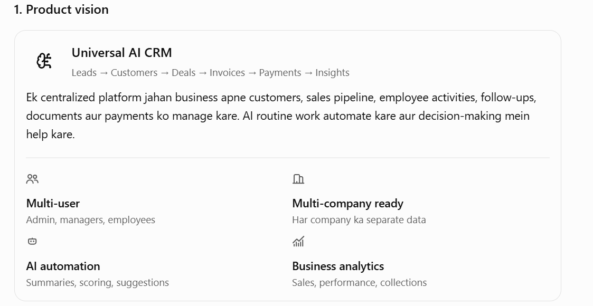
2. Complete module architecture
01 Dashboard & Business Overview
Revenue, active leads, deals, overdue tasks, payment dues aur team KPIs.

02 Lead Management
Lead capture, source tracking, duplicate detection, qualification, scoring aur assignment.

03 Contacts & Companies
People, organizations, decision-makers, contact history aur relationships.

04 Sales Pipeline & Deals
Custom stages, deal value, probability, expected close date, won/lost reasons.

05 Activities & Follow-ups
Calls, emails, meetings, tasks, reminders, recurring tasks aur activity timeline.

06 Products, Services & Quotations
Catalog, pricing, discounts, quotes, proposals aur approval workflow.

07 Invoices & Payments
Invoice generation, partial payments, outstanding balances, receipts aur reminders.

08 Employee & Team Management
Departments, reporting managers, assignments, workload aur targets.

09 AI Assistant & Automation
Lead scoring, conversation summaries, email drafting, next-best-action aur workflow rules.

10 Reports & Analytics
Conversion funnels, revenue forecasts, source ROI, employee performance aur exports.

11 Communication & Integrations
Email, calendar, WhatsApp Business API, web forms aur external applications.

12 Administration & Security
Users, roles, permissions, audit trail, organization settings, data retention aur backups.

Recommended navigation
- Home
- Leads
- Contacts
- Companies
- Deals / Pipeline
- Activities / Tasks
- Products & Services
- Quotations / Invoices
- Payments
- AI Assistant
- Reports
- Team
- Automations
- Integrations
- Settings

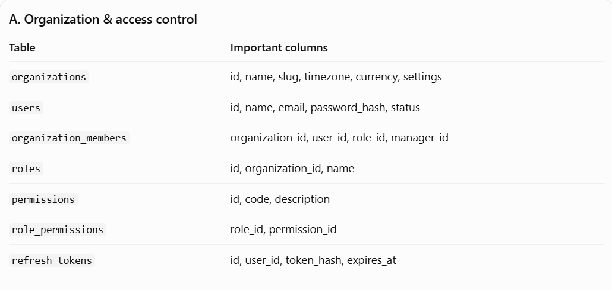
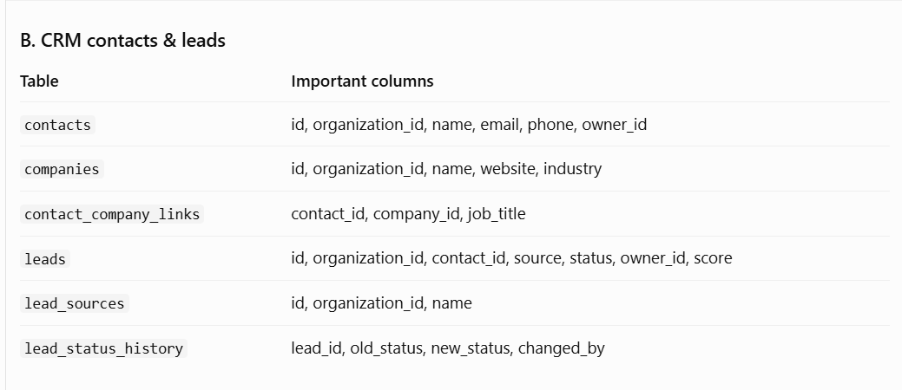
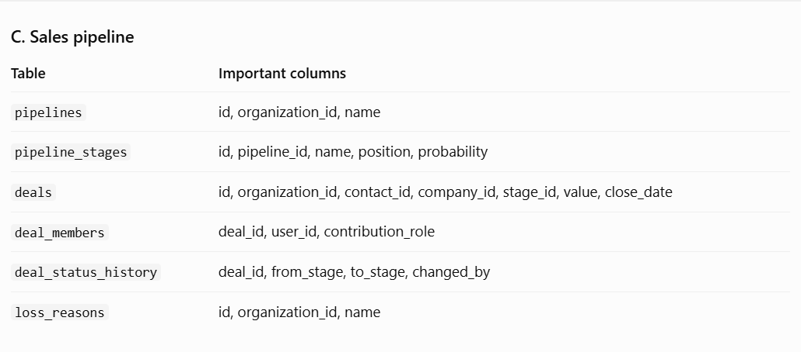
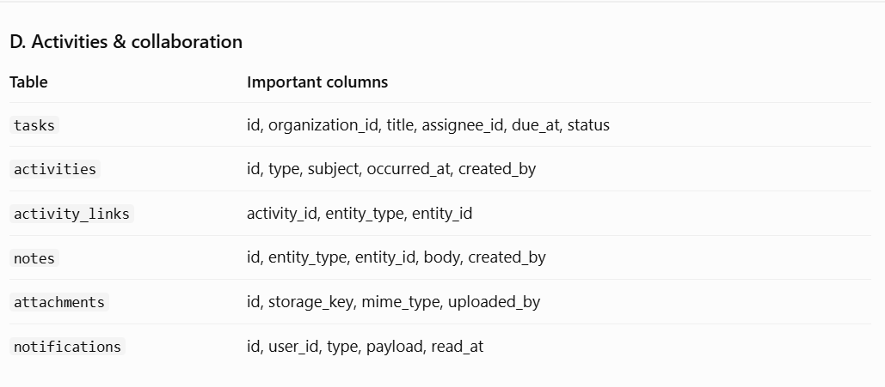
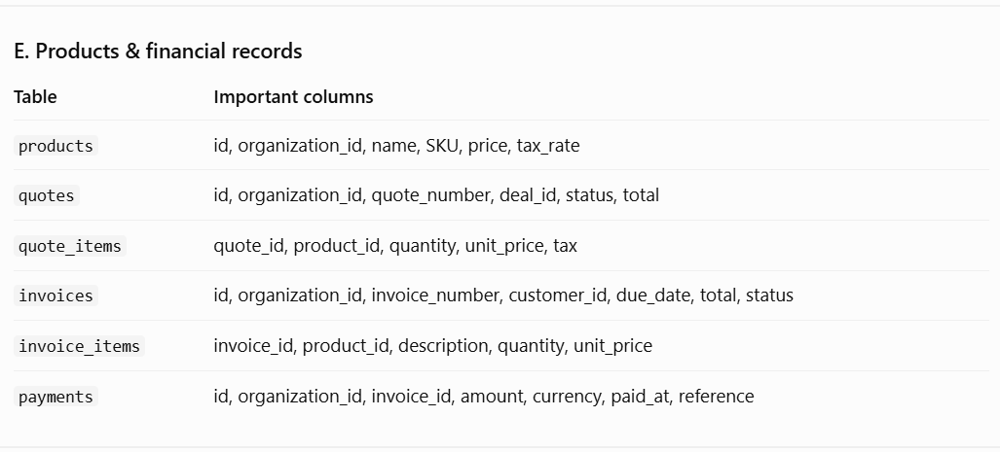
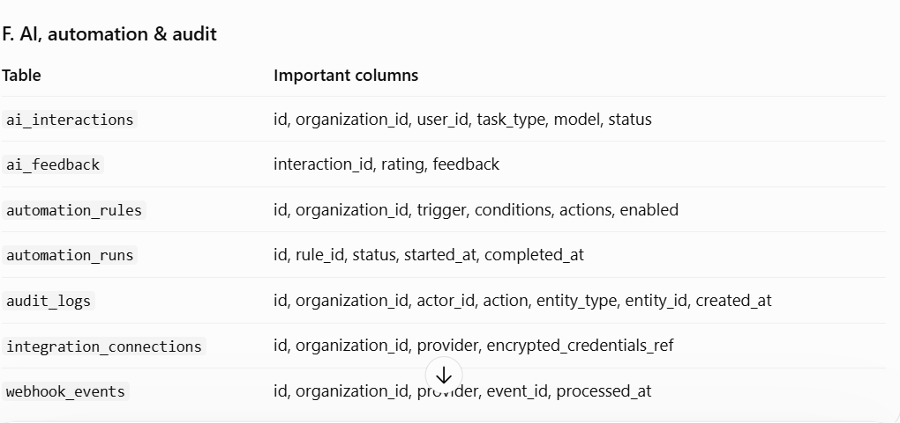
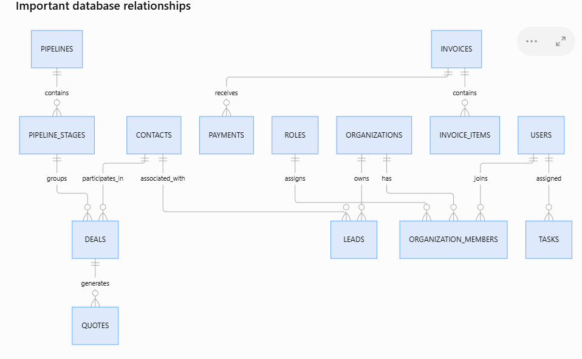
Database design rules
- Har business-owned table mein organization_id rakho, ya explicitly verified parent relationship ke through tenant ownership enforce karo.
- IDs ke liye UUIDs, timestamps ke liye timezone-aware TIMESTAMPTZ use karo.
- Email/phone par blindly unique constraint mat lagao; duplicate detection ko organization ke scope mein controlled logic se handle karo.
- Currency ko invoice/deal ke saath store karo; monetary amounts ko NUMERIC, floating-point ko nahi.
- Invoices aur payments ko hard-delete na karo; correction ke liye void/reversal records aur audit trail use karo.
- Frequently filtered fields par indexes lagao: organization_id, owner_id, status, due_at, created_at.
- PostgreSQL Row-Level Security (RLS) ko additional protection ke roop mein use kar sakte ho. Backend authorization phir bhi mandatory hai.

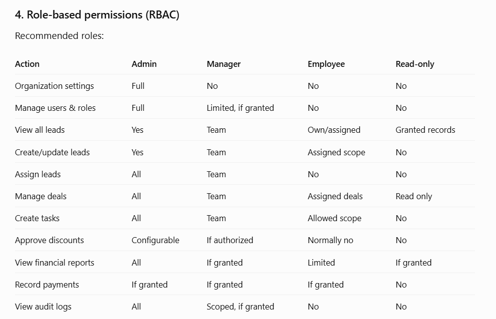

5. REST API endpoints
API versioning shuru se /api/v1 ke saath rakho.
Authentication
POST /api/v1/auth/login
POST /api/v1/auth/refresh
POST /api/v1/auth/logout
POST /api/v1/auth/forgot-password
GET /api/v1/auth/me

Organizations & users
GET /api/v1/organizations/current
GET /api/v1/users
POST /api/v1/users/invitations
PATCH /api/v1/users/{id}
GET /api/v1/roles
PUT /api/v1/roles/{id}/permissions

Leads & contacts
GET /api/v1/leads
POST /api/v1/leads
GET /api/v1/leads/{id}
PATCH /api/v1/leads/{id}
POST /api/v1/leads/{id}/assign
POST /api/v1/leads/{id}/convert
GET /api/v1/contacts
POST /api/v1/contacts

Deals & activities
GET /api/v1/pipelines
POST /api/v1/deals
PATCH /api/v1/deals/{id}
POST /api/v1/deals/{id}/stage
GET /api/v1/tasks
POST /api/v1/tasks
POST /api/v1/activities

Quotes, invoices & payments
POST /api/v1/quotes
POST /api/v1/quotes/{id}/approve
POST /api/v1/invoices
GET /api/v1/invoices/{id}
POST /api/v1/invoices/{id}/payments
POST /api/v1/payments/{id}/refund-or-reverse

AI & automation
POST /api/v1/ai/lead-score
POST /api/v1/ai/summarize-activity
POST /api/v1/ai/draft-email
POST /api/v1/ai/next-best-action
GET /api/v1/automation-rules
POST /api/v1/automation-rules
GET /api/v1/automation-runs

Reports & integrations
GET /api/v1/reports/sales
GET /api/v1/reports/pipeline
GET /api/v1/reports/collections
GET /api/v1/audit-logs
POST /api/v1/integrations/{provider}/connect
POST /api/v1/webhooks/{provider}

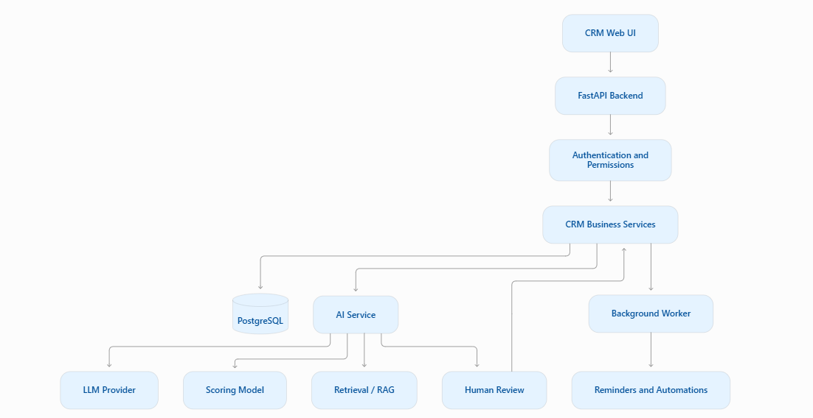
AI ke liye practical rules:
- AI ko direct database write access mat do; validated backend functions ke through actions perform karwao.
- Natural-language reporting ko unrestricted SQL execution na banne do. Allowlisted metrics aur parameterized queries use karo.
- Email send karna, payment change karna, deal close karna ya customer ko message bhejna jaise sensitive actions ke liye confirmation/approval rakho.
- AI prompts, output status, model version aur feedback log karo; unnecessary sensitive customer data store mat karo.
- AI ko customer data se training dene ya third-party provider ke saath share karne se pehle privacy aur retention policies define karo.

7. Recommended technology stack
Tumhare Python aur automation background ko dekhte hue ye stack practical rahega.

Frontend
React + TypeScript
Responsive dashboard, tables, forms, charts, reusable UI components.

Backend
Python + FastAPI
REST APIs, business logic, authorization, validation, OpenAPI documentation.

Database
PostgreSQL + SQLAlchemy + Alembic
Relational data, migrations, transactions, tenant isolation.

Background jobs
Celery + Redis
Scheduled reminders, emails, bulk imports, AI jobs and retries.

AI layer
LLM API + scikit-learn
Email drafts, summaries, natural-language assistant and predictive scoring.

File storage
S3-compatible object storage
Documents, quotations, attachments and exports.

Deployment
Vercel + Render + managed PostgreSQL
Separate frontend/backend deployment, environment variables and managed backups.

Testing & monitoring
Pytest + Playwright + error monitoring
API tests, UI flows, logs, error alerts and uptime monitoring.

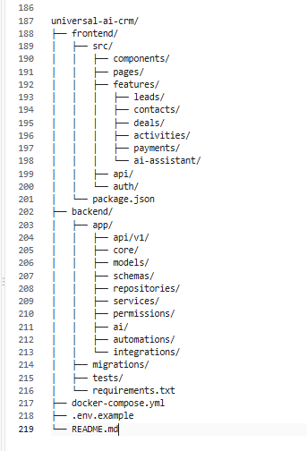